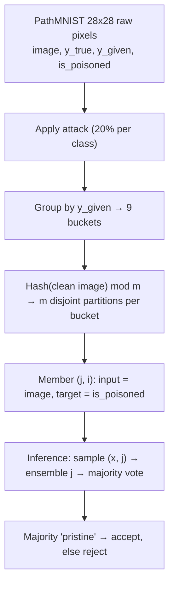

# EoCl Prototype on PathMNIST — Status

**Reference paper:** Roy & Dasgupta, *Enhancing Federated Learning Security: Combating Clients' Data Poisoning with Classifier Ensembles*, CogMI 2024.
**Last updated:** 2026-10-22

---

## 1. What EoCl is
An Ensemble of Classifiers trained centrally at the server (CAS), shipped to FL clients, and used to filter each client's private training data before local training. A sample enters local training only on a majority "pristine" vote.

**Threat model (from the paper):** untargeted, black-box data poisoning of ~5–20% of a client's samples. The paper assumes the EoCl runs key-locked inside a client enclave, so a malicious client cannot skip the filter.

---

## 2. Goal of this prototype
Answer one question: **does a 5-member per-class ensemble detect poisoned samples better than a single classifier?** (Paper's Trend #2.) Scope is Stage 1 only — EoCl training and evaluation at the CAS. No FL yet.

---

## 3. Architecture (same for every attack)

- **9 ensembles**, one per class j, built from samples whose **given** label is j.
- **m members** per ensemble, each trained on one disjoint hash partition of bucket j.
- **Each member:** binary classifier. **Input = image pixels (flattened, 2,352 values). Target = `is_poisoned`.**
- **Labels are never input features.**
  - `y_given` is used only to route a sample to ensemble j (so it is implicitly known inside each ensemble).
  - `y_true` is used only to create the poison and to analyze results. It must never reach a classifier — `is_poisoned` is derivable from it (leakage), and clients don't have it at inference.
- **Hash the clean image bytes**, not the poisoned ones, so partition assignment is stable.

---

## 4. Data

| Item | Spec |
|---|---|
| Dataset | PathMNIST, 28×28 RGB, raw pixels (no backbone, no embeddings) — paper-faithful |
| Classes | 9 tissue types |
| Pool | 40k from official train split |
| Split | 30k train / 5k val / 5k test, stratified by class, fixed seed |
| Columns | `image`, `y_true`, `y_given`, `is_poisoned` |
| Poisoning | Applied to train, val and test |

**Reproducibility:** one global seed (42). Pool sampling and label flips use one seeded NumPy stream, with flips applied in train/val/test order. Stratified splits and stochastic estimators use the same seed. Scale pixels to [0,1]. Save all splits with the four columns above; validation receives label flips but is excluded from fitting, scaler fitting, tuning, and metrics.

---

## 5. Attacks

| | **Label flip (prototype — implement first)** | **Mean shift (next)** |
|---|---|---|
| Attacker changes | Label only | Pixels only |
| Procedure | 20% of each class: `y_given` = uniformly random other class | 20% of each class: add shift to all pixels; label unchanged |
| `y_given` vs `y_true` | Differ on poisoned rows | Always equal |
| `is_poisoned` | `y_given != y_true` | Recorded when the shift is applied |
| Lands in bucket of | The **fake** label | Its **own** class |
| Member must learn | "This image isn't tissue j" | "This tissue-j image was tampered with" |

For label flips, select floor(0.20 × class count) samples independently within each true class of each split. Log the exact flipped count per class and split.

**Mean-shift magnitude (my definition — paper does not specify):** shift = k × std of per-image mean brightness within class j. Keep k small enough that shifted and clean images overlap; if detection is ~100% at every k, the shift is too large (a single brightness threshold would solve it).

---

## 6. Experiment grid (prototype)

| Factor | Values |
|---|---|
| Attack | Label flip (then mean shift) |
| Poison rate | 20% per class |
| Classifier | A = SVM, B = Random Forest (members differ in hyperparameters) |
| m | 1 (monolithic baseline), 5 (ensemble) |

→ 4 runs per attack.

**Fixed prototype settings (no tuning or hyperparameter sampling):**
- Both families: `class_weight="balanced"`.
- SVM: RBF kernel, `gamma="scale"`, C = [0.1, 1, 3, 10, 30]. For m=1 use C=1. Fit `StandardScaler` on each member's own training partition only.
- RF: `max_features="sqrt"`; (n_estimators, max_depth) = [(100, None), (200, None), (100, 20), (200, 20), (300, 30)]. For m=1 use (100, None).
- For m=5, member i uses entry i in list order. Log every member's parameters.

## 7. Metrics
Computed on the 5k EoCl test set, comparing accept/reject against `is_poisoned`:
- Detection accuracy
- Precision (what the paper's Table I reports)
- Recall

Report per run (m × classifier), overall and per class.

Per class means the `y_given` routing bucket. Positive class = poisoned (`is_poisoned=1`); rejection is a positive prediction. Use `zero_division=0` for precision/recall. Log poisoned/pristine counts for every bucket in train/val/test so zero metrics are interpretable.

---

## 8. Known gaps / caveats
- **δα not computable** in this design: at 0% poison, members have no poisoned examples, so the binary target is single-class.
- **Not directly comparable to the paper's Table I**, which used mean-shift.
- MedMNIST exposes no slide/patient IDs; possible same-slide leakage across splits.

## 9. Deferred (not in prototype)
224×224 embeddings · harm check · AUROC · diversity metrics · single-ensemble ablation · poison-rate sweep · m = 3 · Stage 2 (FL) · Stage 3 (server-side update analysis)

**Related work to revisit:** FedGF — flagged by the project author as potentially overlapping with this replication and planned extension, at least partially. Confirm the exact paper and assess the overlap later; reference only, outside the prototype scope.

---

## 10. Next steps
**Prototype status (2026-10-22): Steps 1–5 implemented and run with seed 42.** Entry point: `run_prototype.py`; separate data prep, poisoning, partitioning, training, and evaluation modules. Results are printed and saved to `results/results.csv`; exact flip counts, routing-bucket counts, and all 108 member parameter records are saved alongside it. All three four-column splits are saved as pandas pickle files. Four implementation checks passed. Step 6 and all Deferred items remain unimplemented.

1. Data prep: load PathMNIST 28×28, carve 40k pool, split 30/5/5, build columns.
2. Label-flip poisoning (20% per class).
3. Grouping + hash partitioning.
4. Train 9 × m members for SVM and RF, m ∈ {1, 5}.
5. Majority-vote filter + metrics on test set.
6. Add mean-shift attack; rerun the same grid.
